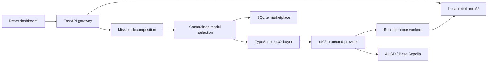

# RoboMarket architecture

A mission becomes a dependency graph of separately purchasable capabilities. The
robot buys inference, uses the output, and only then advances to dependent work.
The graph size follows the number of destinations and requested operations.

## Decisions

* Python packages separate marketplace, simulation, models, and agent ownership.
  One FastAPI gateway composes them for the first demo. Each component also has an
  independent ASGI entry point. No message broker is needed.
* React/Vite avoids server rendering overhead for a control console. The dev server
  proxies `/api` to Python; the production gateway serves the built client.
* SQLite holds provider metadata, plans, telemetry, and execution records. The
  payment process owns its own SQLite ledger with atomic budget reservations.
* Mission decomposition uses a bounded warehouse task grammar and typed goals,
  rather than pretending unrestricted natural-language understanding. Navigation,
  inspection, and multi-stop delivery expand into perception, route planning, and
  inspection steps. Unsupported goals fail explicitly. New capabilities can be
  registered without changing model selection.
* Every paid step has its own request ID, dependencies, requirements, selected
  provider, receipt, and result. A failed prerequisite blocks its descendants.
  Selection rechecks the remaining mission budget before each purchase.
* Two pretrained torchvision object detectors share an image adapter. Route
  planning is a separately listed deterministic A* service. Computed sensor
  summaries are identified as algorithms, not learned models.
* The simulator can render a sensor image. Pretrained COCO detectors are not
  validated on this synthetic domain. Empty detections do not establish safety.
  Users can supply a real camera image for detector evaluation; it is explicitly
  identified separately from the simulator sensor image.
* Latency is measured locally and updated with an EMA. Quality is unknown until a
  labeled benchmark is supplied. Configured priors are labeled estimates; detector
  confidence is never treated as measured accuracy.
* x402 v2 uses the official SDK, explicit AUSD asset amounts, EIP-712 domain data
  read from the token, and a local SDK facilitator. This avoids assuming a hosted
  facilitator accepts AUSD merely because it accepts USDC on the same network.

## Safety and limits

Local sensors and A* enforce collision avoidance independently of payments.
The robot stops while a required mission result is unavailable. Inference
deadlines cover inference, not chain settlement; blockchain latency can take
seconds. Stale results cannot authorize movement in a changed environment.
Payment uncertainty retains its budget reservation and requires reconciliation;
the system must not automatically purchase again after an ambiguous timeout.

This prototype runs on a trusted developer machine. Internal model endpoints
require a shared service key. The payment signer binds to localhost by default.
Before public deployment add user authentication, TLS, provider identity checks,
rate limits, and a durable queue. Never expose the signer or raw model worker.

## External prerequisites

Live settlement requires a funded robot AUSD wallet, a gas-funded facilitator
wallet, a provider recipient, RPC access, and downloaded model weights. Missing
configuration yields `blocked`, never a fabricated receipt. Local simulation and
planning remain usable without blockchain credentials.
